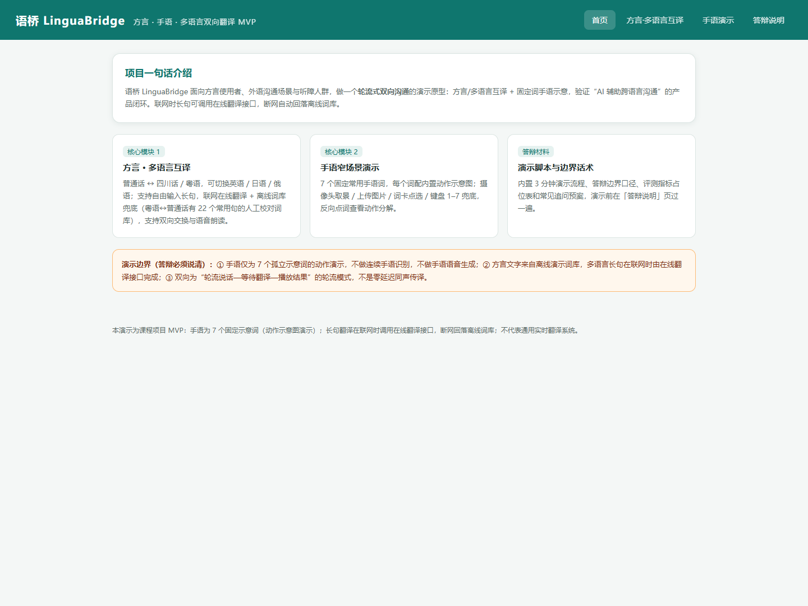
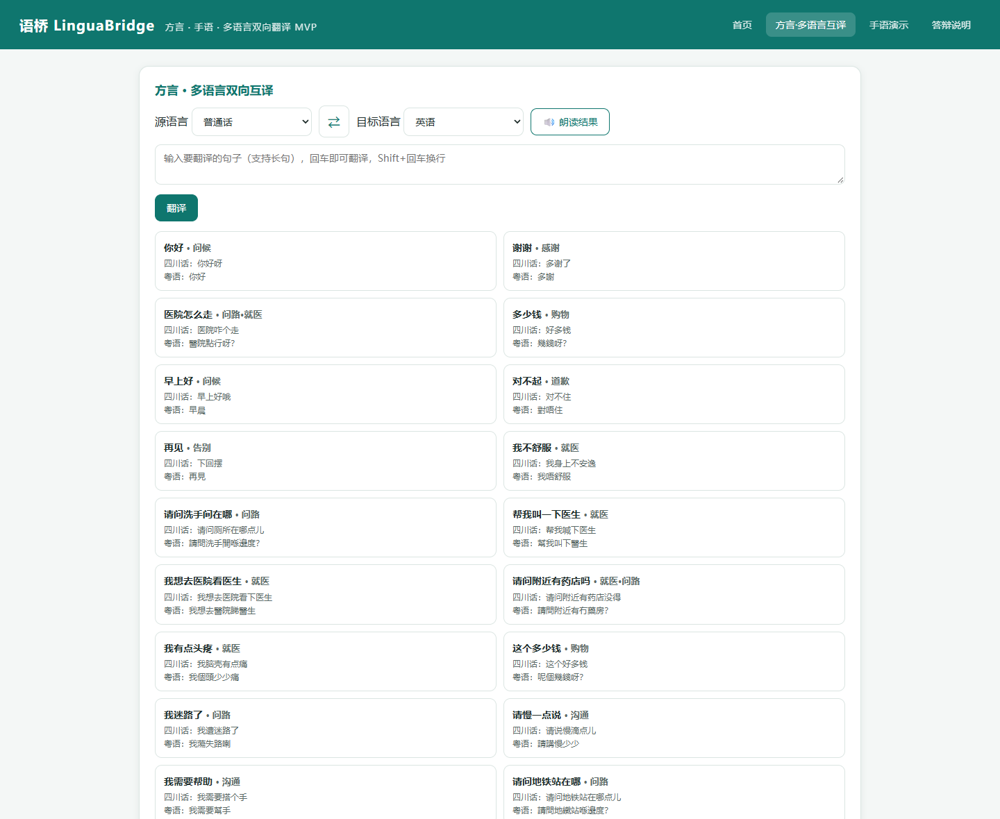
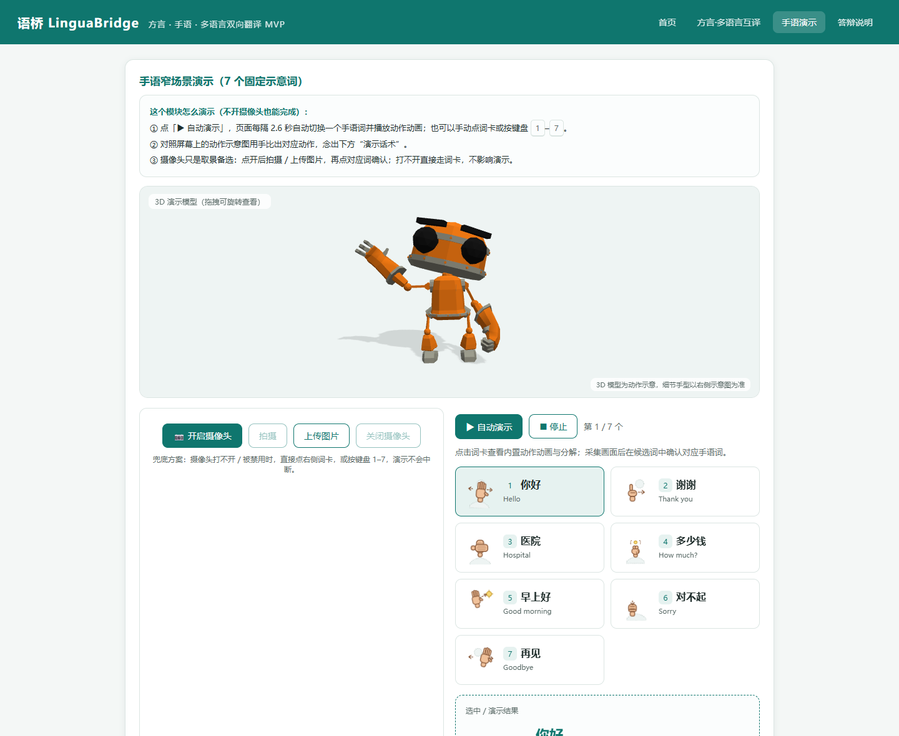

# 语桥 LinguaBridge

**面向方言使用者、外语沟通场景与听障人群的「轮流式双向沟通」演示原型。**

不追求零延迟同传，而是把一次真实沟通拆成可验证的最小闭环：**说出来 → 翻成对方语言 → 对方看懂/听懂 → 再回一句**。当前版本用手语固定词表验证「视觉通道」这一侧的可能性。

> 状态：课程项目 MVP（人工智能技术应用专业，大一）
> 形态：纯静态网页，双击即用，联网增强、断网可演示

在线演示：https://xuelongou.github.io/LinguaBridge/（仓库 Pages 开启后生效）

---

## 界面预览

**① 首页：三条通道入口 + 边界提示**



**② 方言·多语言互译：离线词库兜底、大字投屏卡片、对话记录**



**③ 手语演示：3D 模型舞台（可拖拽旋转）+ 7 个固定示意词**



---

## 一、这个项目解决什么问题

三类人被主流翻译工具漏掉：

| 人群 | 现实困难 | 本项目的做法 |
|---|---|---|
| 方言使用者（如四川话老人） | 只会方言，标准翻译工具按普通话输入，语音识别直接失效 | 方言文本先经词库映射为普通话语义，再走翻译 |
| 出境/涉外场景中的普通人 | 短句能查，长句不敢说 | 长句走在线翻译接口，失败回落离线词库与句式规则 |
| 听障人群 | 语音翻译对他们完全不可用 | 手语固定词表示意，用视觉通道替代语音通道 |

**一句话概括**：不是又一个聊天框，而是把「沟通」这件事拆成三条可被检验的通道（文字、语音、视觉），先各自跑通，再谈融合。

## 二、已实现 vs 未实现（边界写在前面）

| 模块 | 已实现 | 明确不做 |
|---|---|---|
| 方言·多语言互译 | 普通话 / 四川话 / **粤语** / 英语 / 日语 / 俄语切换；22 条离线场景短句（每条含四川话 + 粤语双方言对照）；长句在线翻译（MyMemory → Google 兜底）；粤语↔普通话人工词库 + 粤→外两段式级联；英语离线词表 + 句式规则兜底；多轮对话记录；大字对照卡片（投屏用）；语音朗读（粤语用 zh-HK） | 方言语音识别（ASR）未接入；方言语音合成不做；粤语仅在词库范围内承诺准确 |
| 手语演示 | 7 个固定示意词；每个词含手位、三步动作分解、使用场景、要点提示、演示话术；3D 舞台（可拖拽旋转，内置动作片段）；自动演示 / 词卡 / 键盘 1–7 / 摄像头取景四路兜底 | 连续手语识别；手语生成（文字→手语动画）；真实手语语法 |
| 互通 | 互译结果命中已收录词时，可一键跳到对应手语词 | 任意句子自动转手语 |

> 「双向」指**轮流式双向**：一方说完、系统出结果、另一方再回应。不是同声传译。

## 三、快速开始

**在线**（推荐给评审）
打开上面的 Pages 链接，四个页面直接可用，无需安装任何环境。

**本地（Windows）**
1. 下载仓库（Code → Download ZIP）并解压；
2. 双击 `启动演示.bat`，浏览器自动打开；被安全软件拦截时直接双击 `index.html`；
3. 摄像头是备选取景，拒绝授权不影响任何演示。

**其他系统**：直接用 Chrome / Edge 打开 `index.html` 即可。

## 四、目录结构

```
LinguaBridge/
├─ index.html          主程序：单文件自包含（内联 CSS/JS/SVG，hash 路由四视图）
├─ assets/             离线三维运行时
│  ├─ three.min.js     three.js r128
│  ├─ GLTFLoader.js    模型加载
│  ├─ OrbitControls.js 拖拽旋转
│  └─ robot-data.js    内置模型数据（base64，避免 file:// 跨域限制）
├─ 启动演示.bat         Windows 一键启动
├─ docs/images/        README 截图（home / translate / sign）
└─ README.md
```

关键取舍：**所有资源内联或本地化**，不依赖 CDN，答辩现场断网也不会白屏。

## 五、技术实现

- **前端**：原生 HTML/CSS/JS，无框架、无构建步骤；`#/home`、`#/translate`、`#/sign`、`#/defense` 四视图 hash 路由。
- **翻译链**：`MyMemory` → `Google gtx` → 离线规则，逐级降级，每级 3s 超时；线上失败立即回落，不阻塞演示。
- **粤语链路（两段式）**：粤语 ↔ 普通话先走**人工校对词库**（22 个常用句 + 40 余个高频词，繁体字形），命中即直出，这一路是可以当"准确翻译"演示的；粤语 → 英语/日语/俄语则先用词库把粤语转成普通话，再走在线翻译，避免"粤语直接对英文"的误译（实测 `醫院點行 → yue→en` 会翻成 *How does the hospital act*）。
- **3D 手语动作**：模型内置 14 支骨骼动画（Wave / ThumbsUp / Punch / Dance / Jump / No / Yes / Walking…）。7 个词分别绑定其中有肢体动作的片段，再叠加一层整体姿态（挥手侧倾、鞠躬、转头、上弹、左右摆），保证每个词都有可见且互不相同的动作。模型自带动画的骨骼层级与可见网格不一致，逐骨骼旋转不生效，因此改用"整段动画 + 整体姿态"的组合方案。
- **离线兜底**：约 70 词英语词表 + 8 类句式模板（请问X在哪 / 我想去X / 我是X / 我喜欢X…）。
- **语音**：Web Speech API（`speechSynthesis`），语种随目标语言切换。
- **3D**：three.js r128 + 内置 GLB，加载后按包围盒自适应缩放并落地；不支持 WebGL 时自动回退为平面示意图。

## 六、已知限制

1. 在线翻译依赖第三方免费接口，配额受限，属"有时可用"，离线兜底是主路径。
2. 3D 模型为开源占位模型（RobotExpressive），动作取自其内置骨骼动画并按语义做近似绑定，**不是**写实手语动作捕捉；模型只做"动作正在发生"的示意，具体手型以页面右侧示意图与动作分解为准。
3. 粤语仅在词库覆盖的 22 个常用句内可称为准确；词库外的粤语句子走在线机器翻译，属参考级，且输出多为繁体字。
4. 手语仅 7 个孤立词，不具备语法与连续表达能力。
5. 四川话 / 粤语均为词库映射演示，未接语音识别。
6. 翻译质量未经评测集量化，暂无准确率数字。
7. 无后端、无用户系统，数据不落库。

## 七、路线图

- [ ] 建立测试集（30–50 条场景句）+ 准确率脚本，产出 baseline 数字
- [ ] 词库按场景分组扩充至 60 条以上
- [ ] 手语词表扩展至 12–15 个，补手型动画
- [ ] 接入 ASR，跑通「方言语音 → 文本 → 翻译 → TTS」完整链路
- [ ] 粤语词库按场景分组扩充至 60 句，并引入粤语专用 ASR / TTS
- [ ] 手语侧：摄像头手部关键点 → 轻量分类器，做 7 词闭集识别

## 八、素材与许可

三维运行时为 three.js（MIT）。内置模型来自 three.js 官方示例库（RobotExpressive），沿用其仓库许可；如需商用请自行核查授权范围。本项目暂未声明开源许可证。
